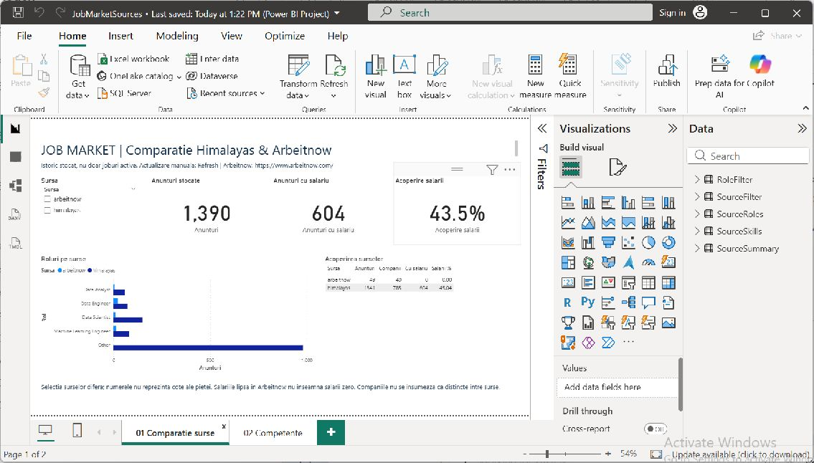
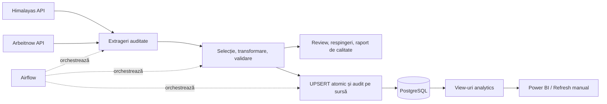
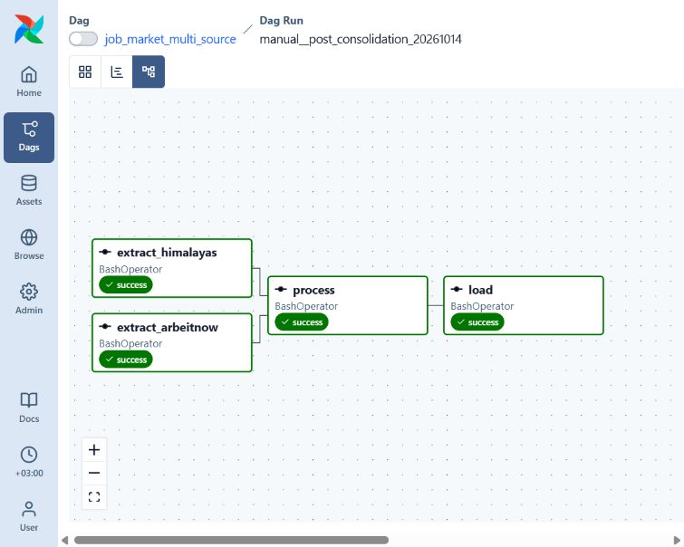
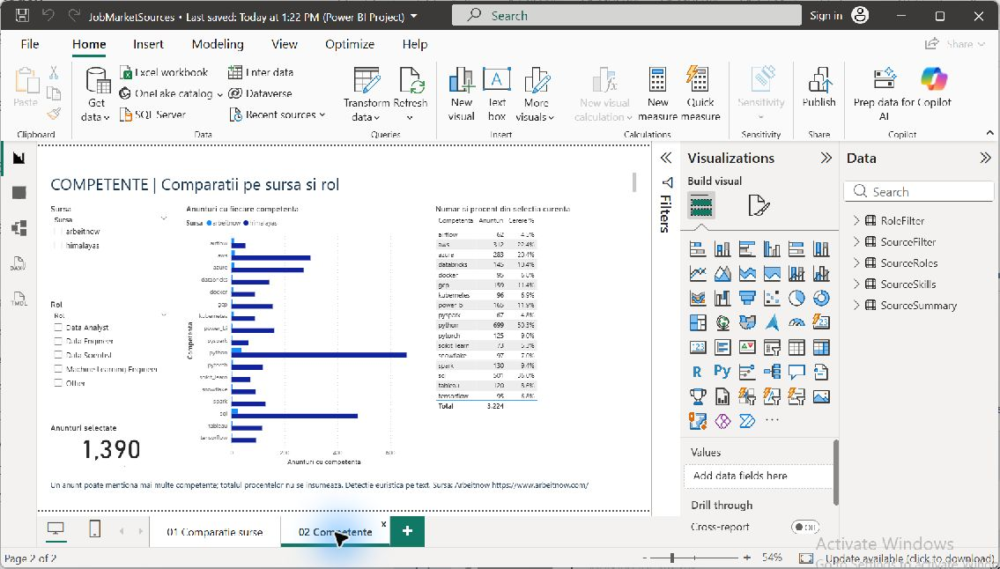

# Job Market Data Platform

Platformă de Data Engineering care colectează anunțuri din **Himalayas și Arbeitnow**, le transformă și validează, apoi le încarcă incremental în PostgreSQL. Airflow orchestrează procesarea, auditul urmărește fiecare sursă, iar Power BI prezintă rolurile și competențele.

[Operare](docs/OPERATIONS.md) · [Audit multi-source](docs/MULTIPLE_SOURCES.md)

## Rezultat verificat

Demonstrația din **14.10.2026**, după consolidarea bazei: **1.390 de anunțuri istorice** (1.341 Himalayas, 49 Arbeitnow), 604 cu salariu și **43,5% acoperire salarială**. Toate cele patru taskuri Airflow au reușit, iar Refresh-ul Power BI a confirmat totalurile SQL. Rularea manuală a inserat 2 joburi, actualizat 10 și omis 360 neschimbate, fără respingeri tehnice sau identități duplicate. [Dovezi agregate](docs/evidence/post-consolidation-demo-20261014.json).



## Arhitectură



- Identitate pe sursă, încărcare incrementală și audit de extragere/încărcare.
- Selecție conservatoare Arbeitnow; candidații ambigui rămân pentru review.
- Migrări repetabile, tranzacționale, înaintea serviciilor care consumă date.
- Raport Power BI cu două pagini, filtre de sursă/rol și view-uri SQL.
- Fluxul original Himalayas rămâne disponibil: extract → transform → validate → load → PySpark.

Arhivarea Azure Data Lake Gen2 și notebookurile Databricks Free Edition sunt extensii separate. Transferul în Free Edition este manual; operațiile cloud nu sunt incluse implicit în DAG-ul multi-source.

## Tehnologii

Python, Pandas, SQLAlchemy, PostgreSQL 18, Apache Airflow 3.3.2 / LocalExecutor, Docker Compose, PySpark, Azure Data Lake Storage Gen2, Databricks Free Edition, Power BI, Pytest și GitHub Actions.

## Pornire

Pe un calculator nou, copiază `.env.example` în `.env`, completează secretele local și alege explicit numele Compose și porturile. Exemplul principal folosește `job-market-data-platform`, PostgreSQL `5433`, Airflow `8080`. Nu rescrie un `.env` existent. Pentru volume existente păstrează numele proiectului și parola bazei și urmează [procedura de upgrade](docs/OPERATIONS.md).

```powershell
docker compose build airflow-init airflow-api-server airflow-scheduler airflow-dag-processor
docker compose up -d airflow-api-server airflow-scheduler airflow-dag-processor
docker compose ps -a
```

`db-migrate` aplică migrările 001–006 și ambele seturi de view-uri într-o tranzacție; consumatorii așteaptă succesul ei. `airflow-init` migrează separat metadatele. Exit 0 pentru aceste servicii este normal. Nu șterge volumele pentru upgrade.

**Configurația laptopului demonstrat:** folder operator `D:/Proiecte/job-market-data-platform`, PostgreSQL `localhost:15435`, Airflow `http://localhost:18083`. `.env` păstrează numele Compose `job-market-data-platform-sources` pentru reutilizarea volumelor consolidate. Baza business veche este oprită; backup-urile au trecut restaurarea integrală. Nu porni stiva din vechiul worktree sources. [Consolidare](docs/evidence/database-consolidation-20261014.json).

Toate programările sunt oprite: `schedule=None`, DAG-uri pe pauză, Databricks `PAUSED`, Azure upload dezactivat. Pornirea serviciilor nu declanșează ingestia. În Airflow, o demonstrație live necesită un Trigger manual al `job_market_multi_source`, cu `mode=live`; apoi DAG-ul se pune din nou pe pauză.



## Power BI

Deschide `powerbi/JobMarketSources.pbip`, păstrând folderele Report și SemanticModel lângă el. Raportul folosește `UsePostgreSQL=true`, `DatabaseServer=localhost:15435`; pe altă instalare setează portul ales în `.env`. Introdu credențialele personal în Desktop și execută Refresh. Mod Import, fără publicare sau refresh programat în Service.



Pentru demo offline, setează `UsePostgreSQL=false` și execută Refresh: snapshotul inclus din **10.10.2026 are 468 de joburi**, diferit de baza consolidată. Raportul original `powerbi/JobMarket.pbip` păstrează propriul snapshot și conexiuni PostgreSQL la același port local. [Ghid Sources](powerbi/SOURCES_README.md) · [Raport original](powerbi/README.md).

## Model și limite

`jobs`, `companies`, `skills`, `job_skills` păstrează modelul relațional; `source_extraction_attempts` și `source_load_runs` urmăresc sursele. Fluxul original folosește `job_runs`, `job_run_attempts`, reconciliere și alerte persistente. [Contractele etapelor](docs/airflow-stages.md).

Datele includ istoric și anunțuri expirate; nu reprezintă întreaga piață. Identitatea pe sursă nu elimină automat anunțurile similare între surse. Clasificarea rolurilor și competențelor este euristică. Procentele competențelor nu se însumează; salariile absente nu sunt zero și nu sunt convertite între monede/perioade. Retenția automată și reconcilierea întreruperilor auditului multi-source rămân extensii viitoare.

## Verificări

```powershell
python -m pip install -r requirements.txt -r requirements.spark.txt
python -m pytest -v
```

Testele Spark necesită Java 17. Integrarea folosește o bază dedicată cu nume terminat în `_test`, niciodată baza business. CI verifică și bootstrap-ul/backfill-ul și reaplicarea migrărilor. Pentru prezentare, [scriptul SQL doar pentru citire](sql/demo_checks.sql) verifică auditul, totalurile și identitățile duplicate.

Pentru oprire fără ștergerea datelor: `docker compose stop`. [Istoricul proiectului](docs/PROJECT_HISTORY.md) · [Operare completă](docs/OPERATIONS.md).
