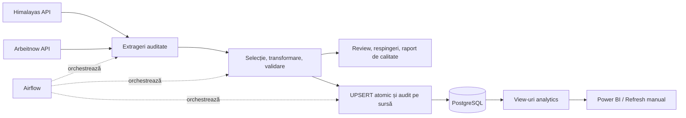
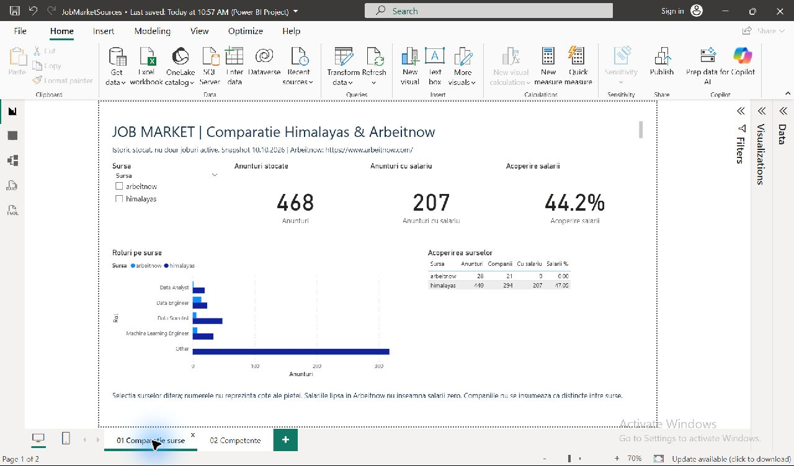

# Job Market Data Platform

Platformă de Data Engineering care colectează anunțuri din **Himalayas și Arbeitnow**, le transformă și validează, apoi le încarcă incremental în PostgreSQL. Airflow orchestrează procesarea, auditul urmărește fiecare sursă, iar Power BI prezintă rolurile și competențele.

## Starea actuală

- DAG multi-source verificat live: două extrageri paralele → selecție/transformare/validare → încărcare atomică.
- Proveniență și identitate pe sursă; UPSERT, audit de extragere și încărcare, candidați ambigui păstrați pentru revizuire.
- Raportul `JobMarketSources.pbip` importă datele din PostgreSQL la Refresh. Include și un snapshot offline separat.
- Pipeline-ul original Himalayas rămâne disponibil: extract → transform → validate → load → PySpark.
- Arhivare opțională Azure Data Lake Gen2 și notebookuri Databricks Free Edition; transferul către Free Edition este manual.
- Toate programările sunt oprite (`schedule=None`, Databricks `PAUSED`). Pornirea serviciilor nu declanșează ingestia.

## Arhitectură



Fluxul original poate arhiva raw în Azure și procesa același snapshot cu PySpark în Parquet. Aceste operații cloud nu sunt adăugate implicit DAG-ului multi-source.

## Tehnologii

Python, Pandas, SQLAlchemy, PostgreSQL 18, Apache Airflow 3.3.2 / LocalExecutor, Docker Compose, PySpark, Azure Data Lake Storage Gen2, Databricks Free Edition, Power BI, Pytest și GitHub Actions.

## Instalare și upgrade

1. Pornește Docker Desktop cu Linux containers. Copiază `.env.example` în `.env` și înlocuiește parolele/secretele demonstrative.
2. Alege explicit **o singură stivă**. Numele Compose determină și volumele. Pentru o instalare principală, exemplul folosește `job-market-data-platform`, PostgreSQL `5433`, Airflow `8080`. Pentru worktree-ul separat sources folosește `job-market-data-platform-sources`, `15435`, `18083`. Nu rescrie un `.env` existent și păstrează parola volumului existent.
3. Construiește și pornește:

```powershell
docker compose build airflow-init airflow-api-server airflow-scheduler airflow-dag-processor
docker compose up -d airflow-api-server airflow-scheduler airflow-dag-processor
docker compose ps -a
```

Pe o bază nouă se execută `sql/init.sql`, apoi serviciul **db-migrate** aplică migrările 001–006 și ambele seturi de view-uri într-o tranzacție. ETL, loaderul sources și serviciile Airflow care consumă date așteaptă migrarea reușită. `airflow-init` migrează separat metadatele Airflow. Exit 0 pentru cele două servicii de inițializare este normal.

Pentru **upgrade-ul unui volum existent**, fă mai întâi backup și oprește serviciile care pot încărca date. Rulează din folderul care deține stiva, cu același `.env`, nume Compose și parolă:

```powershell
docker compose stop airflow-scheduler airflow-api-server airflow-dag-processor
docker compose up -d db
docker compose run --rm db-migrate
# Numai după Exit 0:
docker compose up -d airflow-api-server airflow-scheduler airflow-dag-processor
```

Migrările sunt repetabile, păstrează datele și completează proveniența rândurilor Himalayas existente. Nu se combină bazele celor două stive. Nu șterge volumele pentru upgrade. [Ghid complet și alegerea bazei finale](docs/OPERATIONS.md).

## Demonstrație multi-source

Deschide Airflow la portul ales în `.env`. Autentificarea locală este descrisă în [OPERATIONS.md](docs/OPERATIONS.md). Scoate `job_market_multi_source` de pe pauză, declanșează manual cu `mode=live`, apoi verifică `extract_himalayas`, `extract_arbeitnow`, `process`, `load`. După succes, pune DAG-ul din nou pe pauză.

Modul implicit `snapshot` necesită fișiere locale în `data/sources/input`, care nu sunt publicate. Pentru date noi alege explicit `live`. Nu activa o programare pentru demonstrație. În Power BI apasă Refresh după terminarea DAG-ului.

Rularea din **14.10.2026**: toate cele patru taskuri success, 371 acceptate tehnic, 370 inserate și 1 omis, zero respingeri de calitate. Cele 26 de candidate Arbeitnow ambigue nu au fost încărcate. Baza cumulată și Power BI: **838 anunțuri istorice** (791 Himalayas, 47 Arbeitnow), 369 cu salariu, 44,0% acoperire. [Audit și procedură](docs/MULTIPLE_SOURCES.md) · [Dovezi agregate](docs/evidence/demo-multi-source-20261014.json).



Captura de mai sus a fost realizată la 11.10.2026 pe snapshotul de 468 de anunțuri; nu ilustrează totalul bazei după lotul din 14.10.2026.

## Power BI

- **Sources:** `powerbi/JobMarketSources.pbip`, două pagini cu filtre sursă/rol; import PostgreSQL verificat. Raportul este salvat cu `UsePostgreSQL=true`, `DatabaseServer=localhost:15435`, corespunzător bazei sources. Dacă folosești stiva principală, schimbă serverul la portul ei (de exemplu `localhost:5433`). Credențialele se introduc personal în Desktop.
- **Demo offline:** setează `UsePostgreSQL=false`, aplică și apasă Refresh. Snapshotul inclus din 10.10.2026 conține 468 de anunțuri; nu colectează date noi.
- **Raport original:** `powerbi/JobMarket.pbip`, trei pagini pentru roluri, companii, competențe și salarii; are propriul snapshot demonstrativ.

Păstrează folderele raportului și modelului lângă PBIP. Nu există publicare sau refresh programat în Service. [Ghid Sources](powerbi/SOURCES_README.md) · [Ghid raport original](powerbi/README.md).

## Model și limite

`jobs`, `companies`, `skills`, `job_skills` păstrează datele relaționale; `source_extraction_attempts` și `source_load_runs` urmăresc sursele. Fluxul original folosește `job_runs`, `job_run_attempts`, reconciliere și alerte persistente. [Contractele etapelor](docs/airflow-stages.md).

Datele includ istoric și anunțuri expirate; nu reprezintă întreaga piață. Deduplicarea de identitate nu elimină automat anunțurile similare între surse. Selecția Arbeitnow este conservatoare; clasificarea Himalayas și detectarea competențelor sunt euristice. Procentele competențelor nu se însumează. Arbeitnow nu furnizează salarii; valorile lipsă nu sunt salarii zero. Salariile nu sunt convertite între monede/perioade. Reconcilierea întreruperilor auditului multi-source rămâne o extensie viitoare.

## Teste

```powershell
python -m pip install -r requirements.txt -r requirements.spark.txt
python -m pytest -v
```

Integrarea folosește `TEST_DATABASE_URL` către o bază dedicată cu nume terminat în `_test`; niciodată baza de business. Java 17 este necesar pentru Spark. Regresia pre-merge din 14.10.2026: 78 teste Python/PostgreSQL și 5 teste Spark trecute, o comparație cu un snapshot local omisă. Verificarea noului bootstrap este descrisă în [OPERATIONS.md](docs/OPERATIONS.md).

## Azure, Databricks și istoricul demonstrațiilor

`AZURE_UPLOAD_ENABLED=false` este implicit. Activarea necesită cont ADLS Gen2, containere private și rolul Storage Blob Data Contributor pentru aplicație. Datele stocate deja pot consuma credit chiar cu programările oprite. [Operare Azure](docs/OPERATIONS.md) · [Databricks](databricks/README.md).

[Capturi și verificări istorice v1](docs/PROJECT_HISTORY.md) · [Dezvoltarea multi-source](docs/MULTIPLE_SOURCES.md). Extensia ML rămâne pe ramura sa separată. `.env`, cache-urile, PBIX, datele brute/intermediare și documentația personală sunt excluse din Git.
