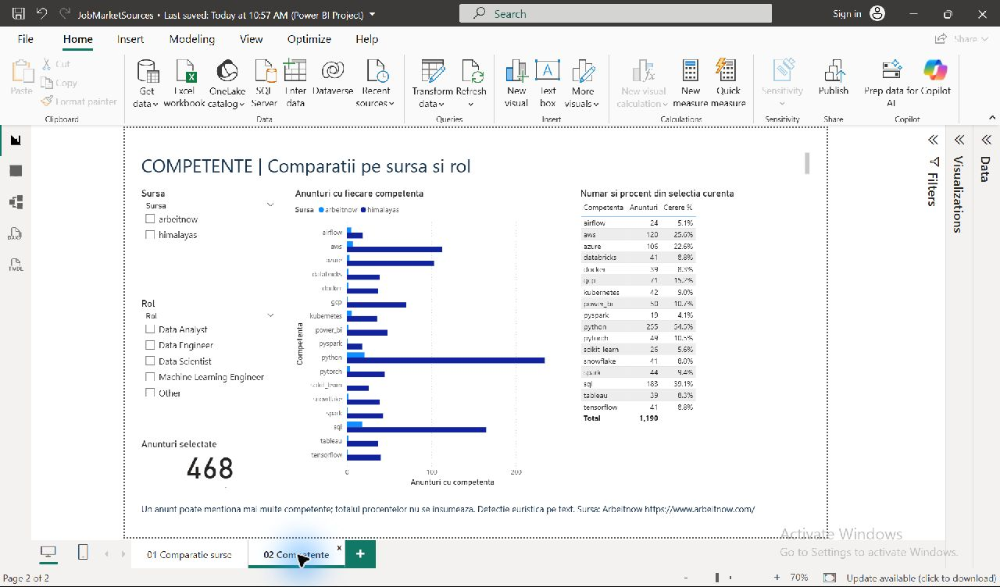

# Compararea surselor în Power BI

Deschide `JobMarketSources.pbip` în Power BI Desktop. Raportul are două pagini, verificate în Desktop la 11 octombrie 2026. Păstrează folderele `JobMarketSources.Report` și `JobMarketSources.SemanticModel` lângă PBIP. La prima deschidere dintr-un clone fără cache, execută Refresh. Raportul original `JobMarket` este separat.

## Pagini și interpretare

1. **Comparatie surse**: filtrare pe sursă, anunțuri stocate, anunțuri cu salariu, acoperire salarială, distribuție pe rol și sumar pe sursă. Sumarul nu are granularitate de rol, de aceea această pagină nu conține filtru pe rol.
2. **Competente**: filtre pe sursă și rol, numărul anunțurilor selectate, grafic pe competențe și tabel cu număr și procent.

Cererea unei competențe = anunțuri cu competența / toate anunțurile surselor și rolurilor selectate. Totalul procentual este gol intenționat; anunțurile pot menționa mai multe competențe. Totalul numeric din tabel reprezintă asocieri anunț–competență, nu anunțuri distincte. Relațiile SourceFilter și RoleFilter filtrează agregatele unidirecțional. Companiile nu se însumează între surse ca număr distinct global.

## Snapshot și verificări

Snapshot agregat din PostgreSQL sources la 10.10.2026: **468 anunțuri stocate**, **440 Himalayas**, **28 Arbeitnow**, 9 grupe sursă/rol și 101 grupe sursă/rol/competență. Include istoricul, nu numai lotul live de 348; nu reprezintă exclusiv anunțuri active. Nu elimină duplicatele semantice între surse.

Verificat în Desktop: fără filtre 468 anunțuri, 207 cu salariu și 44,2% acoperire; filtrul Arbeitnow produce 28 anunțuri, 0 cu salariu și 0,0%. Himalayas are 207/440 anunțuri cu salariu (47,05%). API-ul Arbeitnow nu oferă câmpuri salariale; lipsa lor nu înseamnă salariu zero.

Filtrul Arbeitnow + Data Engineer produce 14 anunțuri, Python 9/14 (64,3%) și SQL 11/14 (78,6%). Valorile corespund snapshotului SQL. Totalul procentual este gol. Ambele pagini și Refresh-ul snapshotului au fost verificate, raportul a fost salvat din aplicație, filtrele de test au fost resetate. 21 de definiții JSON au trecut validarea schemelor oficiale Microsoft înainte de salvarea din Desktop.

## Actualizare din PostgreSQL

View-urile `sql/source_analytics_views.sql` sunt aplicate bazei sources: `analytics.source_summary`, `source_roles`, `source_skills`. Pentru altă bază aplică întâi migrările 004–006.

În Transform data → Edit parameters setează `UsePostgreSQL=true`, `DatabaseServer=localhost:15435`, apoi aplică și execută Refresh. Baza este `job_market_db`. Introdu personal credențialele la solicitarea Desktop; nu le scrie în M sau documentație. Mod Import. **Importul PostgreSQL a fost verificat în Desktop la 14.10.2026**, după aprobarea interogărilor și autentificarea efectuate personal de utilizatoare. Un nou Refresh s-a încheiat fără erori. Raportul este salvat cu `UsePostgreSQL=true` și serverul `localhost:15435`; Docker și serviciul `db` trebuie să fie pornite pentru actualizare. Pentru demonstrație fără bază de date, setează `UsePostgreSQL=false`, aplică și execută Refresh: se reîncarcă snapshotul inclus, fără colectare de date noi. Credențialele locale nu sunt incluse în proiectul text; pe alt calculator vor trebui introduse din nou. Nu există publicare în Service sau refresh programat configurat.

## Capturi și limite

Atribuire: [Arbeitnow](https://www.arbeitnow.com/). Diferențele depind de selecție, geografie, perioadă și reguli de clasificare; nu reprezintă cote reale ale pieței. Detectarea competențelor și clasificarea Other Himalayas sunt euristice. Comparația salarială între surse nu este disponibilă.

### Verificare PostgreSQL — 14.10.2026

Refresh complet din PostgreSQL, fără erori. Rezultatul corespunde celor trei view-uri: 468 anunțuri (440 Himalayas, 28 Arbeitnow), 207 cu salariu, 44,2% global; 9 grupe sursă/rol și 101 grupe sursă/rol/competență. Filtrul Arbeitnow + Data Engineer: 14 anunțuri, Python 9/64,3%, SQL 11/78,6%, total procentual gol. Filtrele au fost resetate și raportul salvat din Desktop. Nu s-a rulat un lot ETL și nu s-au modificat datele pentru test. După o viitoare rulare ETL, folosește Refresh în Power BI; modul Import nu urmărește automat schimbările bazei. Capturile de mai sus rămân cele din 11.10.2026.

## Ultima demonstrație live — 14.10.2026

După rularea manuală Airflow, Refresh din PostgreSQL a actualizat raportul de la 468 la **838 anunțuri** (791 Himalayas, 47 Arbeitnow), **369 cu salariu, 44,0%**. Arbeitnow + Data Engineer: 22 anunțuri, Python16/72,7%, SQL13/59,1%. Raportul a fost salvat și redeschis cu noile valori; filtrele de test au fost resetate. Aceste valori sunt starea bazei după demonstrație; snapshotul offline inclus rămâne cel din 10.10.2026. Pași și audit: [demonstrația completă](../docs/MULTIPLE_SOURCES.md#demonstrație-completă--14-octombrie-2026).

## Consolidare verificata — 14.10.2026

Baza activa unica are **1.388 de joburi** (1.341 Himalayas, 47 Arbeitnow), dupa importul a 550 de joburi lipsa din v1. Datele si auditurile anterioare au fost pastrate; backup-urile au trecut restaurarea integrala. Folderul operator este proiectul principal, cu PostgreSQL pe **15435** si Airflow pe **18083**, pastrand volumele stivei sources. Baza veche este oprita. Programarile raman oprite. Valorile/capturile anterioare descriu rularile lor istorice. Refresh-ul Power BI dupa consolidare ramane de efectuat in Desktop. Vezi [procedura](../docs/OPERATIONS.md).

## Verificare dupa consolidare — 14.10.2026

Rulare manuala live `manual__post_consolidation_20261014`: toate cele4 taskuri Airflow success. Himalayas: 351 acceptate, 351 omise ca neschimbate. Arbeitnow: 21 acceptate, 2 inserate, 10 actualizate, 9 omise. Zero respingeri tehnice si zero identitati duplicate. Baza are acum 1.390 de joburi (1.341 Himalayas, 49 Arbeitnow), dintre care604 cu salariu.

Refresh complet Schema and data verificat in Power BI Desktop: 1.390 anunturi,604 cu salariu,43,5% acoperire; tabelul surselor corespunde SQL. Raportul a fost salvat. Toate cele4 DAG-uri au revenit pe pauza; programarile raman None si Azure upload false. Valorile1388 din consolidare si838 din demonstratia anterioara sunt istorice, nu totaluri curente. Dovezi agregate: `docs/evidence/post-consolidation-demo-20261014.json`.
